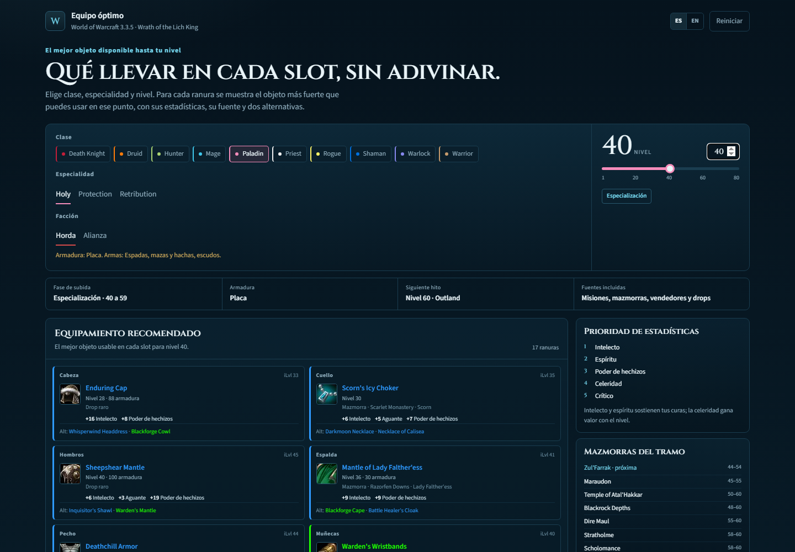

# WotLK Leveling Gear

[English](README.md) | **Español**

[](LICENSE)


Guía estática que responde una pregunta:

> ¿Cuál es el objeto más fuerte que puedo equipar en cada slot a mi nivel actual?

Incluye las 10 clases de WotLK, 31 especialidades, niveles 1–80, Horda/Alianza y español/inglés.



## Características

- **Ficha de equipamiento completa**: cabeza, cuello, hombros, espalda, pecho, muñecas, manos, cintura, piernas, pies, anillos, abalorios, mano principal, mano secundaria, a distancia y reliquia.
- **Mejor objeto por slot** con dos alternativas.
- **Filtro de facción**: las misiones y vendedores se ajustan a Horda o Alianza.
- **Interfaz bilingüe**: español e inglés.
- **Detalle de cada objeto**: icono, calidad, nivel de objeto, nivel requerido, estadísticas relevantes y fuente.
- **Panel de reliquias de herencia** separado del ranking principal, con tooltips escalados al nivel.
- **Tooltips de EVOWOW** para todos los objetos.
- **Diseño responsive** y selección guardada en `localStorage`.
- **Sin backend** y sin compilación para ver la página.

## Cómo funciona

1. `scripts/fetch_raw.py` descarga los datos crudos de objetos y zonas.
2. `scripts/build_item_db.py` normaliza objetos, estadísticas, niveles requeridos, armadura/armas y fuentes.
3. `scripts/build_recommendations.py` filtra por clase, especialidad, nivel, facción, tipo de armadura y competencia de armas; después puntúa con pesos por rol.
4. `scripts/build_page.py` inyecta el JSON generado en `src/template.html` y escribe `tolltip.html`.

El ranking es una heurística práctica para subir de nivel, no un simulador de combate. Prioriza fuentes de subida y usa PvP o fuentes no registradas solo cuando no hay una alternativa mejor. Se excluyen los objetos de banda detectados por la fuente; algunas cadenas de misión de banda pueden aparecer como misión.

## Inicio rápido

Clona el repositorio y abre `tolltip.html` en el navegador.

Necesitas conexión a internet para las fuentes de Google y los tooltips de EVOWOW. La página funciona sin servidor local.

## Generar desde el código

Requisitos:

- Python 3.10+
- Playwright + Chromium para la prueba de humo

```bash
python -m pip install playwright
python -m playwright install chromium

python scripts/fetch_raw.py
python scripts/build_item_db.py
python scripts/build_recommendations.py
python scripts/build_page.py

python tests/smoke.py
```

`build_page.py` escribe `tolltip.html` en el repositorio y, si existe, también en `~/Desktop/tolltip.html`.

## Estructura del proyecto

```text
.
├── data/                  # gear_data.json generado (los datos crudos se ignoran)
├── docs/                  # capturas para el README
├── legacy/                # implementación anterior, solo reliquias
├── scripts/               # pipeline de datos, ranking y generador de página
├── src/                   # plantilla HTML/CSS/JS
├── tests/                 # prueba de humo con Playwright
├── tolltip.html           # página final autocontenida
├── README.md              # README en inglés
├── CONTRIBUTING.md        # guía de contribución en inglés
├── CONTRIBUTING.es.md     # guía de contribución en español
└── LICENSE
```

## Datos y atribución

La base de objetos se construye a partir de [wow-classic-items](https://github.com/nexus-devs/wow-classic-items):

- `data/json/data.json`
- `data/json/zones.json`

Los tooltips e iconos se cargan desde [EVOWOW](https://wotlk.evowow.com/).

Este proyecto no está afiliado a Blizzard Entertainment. World of Warcraft y Wrath of the Lich King son marcas de Blizzard Entertainment.

## Limitaciones

- La base está basada en WotLK Classic; algunas fuentes originales de 3.3.5 pueden faltar o aparecer como “Otra fuente”.
- El botín de banda se excluye intencionadamente, pero algunas recompensas de misiones de banda pueden aparecer como misión.
- Los pesos de estadísticas son aproximaciones por rol. Sirven para subir de nivel, no sustituyen a un simulador de BiS.
- Algunos slots de niveles muy bajos pueden no tener objetos con estadísticas conocidas.
- La página final incluye los datos incrustados, así que `tolltip.html` pesa alrededor de 3 MB.

## Contribuir

Se aceptan correcciones de objetos, traducciones, mejoras de UI y reportes de errores. Consulta [CONTRIBUTING.es.md](CONTRIBUTING.es.md).

## Licencia

[MIT](LICENSE) © 2026 veksir
