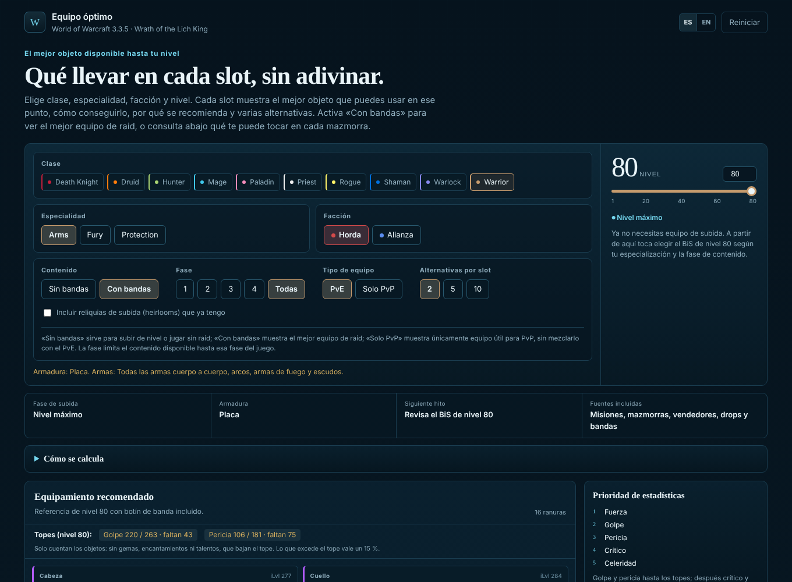

# WotLK Leveling Gear

[English](README.md) | **Español**

[](LICENSE)


Guía de subida y planificador BiS de nivel 80 para WotLK Classic. Responde una pregunta:

> ¿Cuál es el objeto más fuerte que puedo equipar en cada slot a mi nivel actual?

Incluye las 10 clases de WotLK, 31 especialidades, niveles 1–80, Horda/Alianza y español/inglés.



## Contenido

- [Qué hace](#que-hace)
- [Inicio rápido](#inicio-rapido)
- [Funciones](#funciones)
- [Cómo funciona](#como-funciona)
- [Generar y probar](#build-y-tests)
- [Datos y atribución](#datos-y-atribucion)
- [Limitaciones](#limitaciones)
- [Contribuir](#contribuir)
- [Licencia](#licencia)

<a id="que-hace"></a>
## Qué hace

- **Mejor objeto por slot** mientras subes o a nivel 80, con 2, 5 o 10 alternativas ordenadas por puntuación.
- **Ruta de nivel 80**: introduce tu equipo, elige la etapa de tu servidor y mira todas las mejoras sobre lo que llevas.
- **BiS por fase**: Recién 80, Heroicas, T7, T8, T9 y T10, con BiS, BiS² y alternativas.
- **Modelo de equipo**: gemas, meta-gemas, encantamientos, bonus de set, procs de abalorios, topes de golpe/pericia y reliquias de clase.
- **Buscador de botín**: elige una mazmorra o banda y compara cada drop con tu pieza equipada.
- **Una sola página**: sin backend, sin servidor y con las fuentes incrustadas. Tooltips e iconos vienen de EVOWOW; los iconos se pueden incrustar para uso sin conexión.

<a id="inicio-rapido"></a>
## Inicio rápido

1. Clona el repositorio o descarga `tolltip.html`.
2. Abre `tolltip.html` en el navegador.
3. Elige clase, especialidad, nivel, facción y modo de contenido. A nivel 80, introduce tu equipo actual para usar la ruta y las pestañas BiS.

La página funciona sin servidor local. Los tooltips e iconos vienen de EVOWOW; los iconos se pueden incrustar para uso sin conexión con `--icons`.

<a id="funciones"></a>
## Funciones

### Subir de nivel

- **Ficha de equipamiento completa**: cabeza, cuello, hombros, espalda, pecho, muñecas, manos, cintura, piernas, pies, anillos, abalorios, mano principal, mano secundaria, a distancia y reliquia de clase.
- **Mejor objeto por slot** con 2, 5 o 10 alternativas, ordenadas por puntuación.
- **Cómo conseguirlo y por qué**: fuente de cada objeto, enlace a EVOWOW, desglose por estadística, penalización por armadura, siguiente alternativa y avisos.
- **Modos de contenido**: «Sin bandas» (por defecto) o «Con bandas», fase de raid 1–4 o Todas, «Solo PvP» y «Recién 80» (oculta Frost, T10, fichas de raid y PvP).
- **Cobertura al subir**: los objetos con encantamiento aleatorio usan el mejor sufijo para tu especialidad; los blancos solo con armadura rellenan slots vacíos; los slots sin objeto útil muestran la mejor opción con un aviso.
- **Legendarios, reliquias de clase y heirlooms opcionales**: los legendarios aparecen cuando puntúan; las reliquias son equipo normal; las 35 reliquias de subida usan estadísticas exactas por nivel pero siguen siendo opcionales.

### Nivel 80 y BiS

- **Progresión**: a nivel 80 el panel BiS aparece primero y arranca en Recién 80, luego Heroicas (PR) y las bandas.
- **Ruta de 3 pasos**: introduce tu equipo, elige la etapa de tu servidor y consulta todas las mejoras sobre lo que llevas, ordenadas por ganancia (+X%), con su fuente.
- **BiS por fase**: pestañas Recién 80, PR, T7, T8, T9 y T10 (acumulativas), con **BiS**, **BiS²** y **ALT1–ALT6**.
- **T10 curado y bandas por fase**: T10 puede usar la guía de Icy Veins; el botín de banda entra cuando abre su tier y cada slot muestra en «Más adelante» lo que cambia.
- **Plan de farmeo y buscador**: agrupa las piezas BiS que faltan por fuente, o escribe un drop para ver si encaja y en qué puesto queda.
- **Pesos editables, exportar/importar/compartir y piezas equipadas**: ajusta estadísticas, comparte equipo como texto o enlace `#eq=`, y marca lo que ya llevas.

### Modelo de equipo

- **Abalorios con procs**: los efectos de uso y los procs se promedian según duración y enfriamiento (≈); las listas curadas tienen prioridad.
- **Gemas y meta-gemas**: mejor gema por color, bonus de socket solo si se respetan los colores y meta-gema solo si cumple requisitos y coste. El plan de meta-gema sugiere cambios.
- **Bonus de set y topes**: el bonus T10 de 2/4 piezas se reparte solo entre las piezas recomendadas; lo que excede el tope de golpe/pericia vale un 15%.
- **Encantamientos con alternativas**: cada slot muestra el encantamiento de la guía y alternativas; la mejor estadística compartida pasa al primer puesto y los enlaces buscan por nombre en EVOWOW.

### Interfaz y datos

- **Buscador de botín**: elige una mazmorra o banda y compara cada drop con tu pieza equipada; el botín fuera de especialidad queda oculto por defecto.
- **Filtro de facción y bilingüe**: Horda/Alianza, interfaz español/inglés, iconos, calidad, nivel de objeto, estadísticas y fuente.
- **Tooltips de EVOWOW** para todos los objetos, con diseño adaptable y selección guardada en `localStorage`.
- **Navegación y diseño**: barra de secciones fija, filtros plegables en móvil que recuerdan tu elección, foco de teclado visible, texto mínimo de 11 px, objetivos táctiles más grandes e impresión limpia.
- **Sin backend**: una sola página generada, sin servidor y con las fuentes incrustadas.

<details>
<summary><strong>Funciones avanzadas y opcionales</strong></summary>

- **Guías BiS por fase**: solo la guía de T10 viene con el repositorio. Para añadir otra fase, pega su lista en un archivo de texto (`Cabeza: Objeto A; Objeto B`, un slot por línea), ejecuta `python scripts/import_bis_list.py "Paladin|Protection" PR lista.txt`, luego `python scripts/build_recommendations.py` y por último `python scripts/build_page.py`. La lista se guarda en `data/reference_bis_phases.json`; haz commit de ese archivo si quieres que la guía se publique.
- **Iconos sin conexión**: `python scripts/fetch_icons.py` descarga los iconos que usa BiS por fase a `assets/icons/`, y `python scripts/build_page.py --icons assets/icons` los incrusta. La página crece varios MB; sin ese paso los iconos se cargan desde EVOWOW.
- **HTML comprimido**: `python scripts/build_page.py` escribe un `tolltip.html` comprimido (~1,4 MB). `--plain` lo escribe sin comprimir.

</details>

<a id="como-funciona"></a>
## Cómo funciona

1. `scripts/fetch_raw.py` descarga los datos crudos de objetos y zonas; `scripts/fetch_heirloom_stats.py` añade las estadísticas de las reliquias nivel a nivel; `scripts/fetch_atlasloot.py` y `scripts/build_loot.py` añaden las tablas de botín por jefe de WotLK.
2. `scripts/build_item_db.py` normaliza objetos, estadísticas, niveles requeridos, armadura/armas y fuentes.
3. `scripts/build_recommendations.py` genera la base de objetos, definiciones de especialidad, pesos, gemas y meta-gemas de referencia, bonus de set T10, abalorios y reliquias curados, guías BiS y la lista de mazmorras.
4. `scripts/build_page.py` ejecuta el build de Vite sobre `src/` (HTML, CSS y módulos ES) y escribe la página autocontenida `tolltip.html`.

El ranking es una heurística práctica, no un simulador de combate. Ordena por una puntuación ponderada de estadísticas, usa prioridades por especialidad a nivel 80 y pesos por rol durante la subida, penaliza los tipos de armadura que no son ideales para la clase y compara dos manos contra una mano + secundaria.

También promedia procs de abalorios, elige gemas por color, activa el bonus de socket solo si se respetan los colores, usa la meta-gema solo si cumple sus requisitos, reparte el bonus de set T10 solo entre las piezas recomendadas y aplica los topes de golpe/pericia a nivel 80. Las alternativas de encantamiento solo se ordenan por la estadística que comparten; los objetos con encantamiento aleatorio no se puntúan.

<a id="build-y-tests"></a>
## Generar y probar

<details>
<summary>Mostrar comandos de build y pruebas</summary>

Requisitos:

- Python 3.10+
- Node.js 22.12+ (o 20.19+) y npm
- Playwright + Chromium para las pruebas de navegador

```bash
npm ci
python -m pip install -r requirements.txt
python -m playwright install chromium

python scripts/fetch_raw.py
python scripts/fetch_heirloom_stats.py
python scripts/fetch_atlasloot.py
python scripts/build_loot.py
python scripts/build_item_db.py
python scripts/build_recommendations.py
python scripts/build_page.py
```

`build_page.py` escribe `tolltip.html` en el repositorio y, si existe, también en `~/Desktop/tolltip.html`. Usa `--plain` para omitir la compresión.

Guías e iconos opcionales:

```bash
python scripts/import_bis_list.py "Paladin|Protection" PR lista.txt
python scripts/build_recommendations.py
python scripts/build_page.py

python scripts/fetch_icons.py
python scripts/build_page.py --icons assets/icons
```

Pruebas:

```bash
python tests/run_all.py
python tests/check_reference.py
```

`run_all.py` ejecuta las 16 pruebas de navegador/datos del proyecto. `check_reference.py` es una auditoría de aciertos contra las listas de referencia de Icy Veins; la base actual es **493/518** aciertos (431 exactos), y `--min=497` falla hoy, así que no forma parte de `run_all.py`. Consulta [CONTRIBUTING.es.md](CONTRIBUTING.es.md) para la descripción de cada prueba.

</details>

<a id="estructura"></a>
## Estructura del proyecto

<details>
<summary>Mostrar estructura del proyecto</summary>

```text
.
├── assets/fonts/          # Cinzel y Source Sans 3 incluidas (OFL)
├── assets/icons/          # iconos de objeto opcionales (generados)
├── data/                  # gear_data.json generado (los datos crudos se ignoran)
├── docs/                  # capturas para el README
├── legacy/                # implementación anterior, solo reliquias
├── scripts/               # pipeline de datos, ranking y generador de página
├── src/                   # fuente Vite: index.html, styles/, js/
├── tests/                 # pruebas de humo y regresión con Playwright
├── tolltip.html           # página final autocontenida
├── package.json           # dependencias y scripts de Vite
├── vite.config.js         # configuración del build single-file
├── README.md              # README en inglés
├── README.es.md           # README en español
├── CONTRIBUTING.md        # guía de contribución en inglés
├── CONTRIBUTING.es.md     # guía de contribución en español
└── LICENSE
```

</details>

<a id="datos-y-atribucion"></a>
## Datos y atribución

- **Objetos**: [wow-classic-items](https://github.com/nexus-devs/wow-classic-items), desde `data/json/data.json` y `data/json/zones.json`.
- **Tablas de botín**: [AtlasLootClassic](https://github.com/Hoizame/AtlasLootClassic).
- **Tooltips e iconos**: [EVOWOW](https://wotlk.evowow.com/).
- **Estadísticas de reliquias**: tablas por nivel de [WoWWiki archive](https://wowwiki-archive.fandom.com/) y la [API de tooltips de Wowhead WotLK](https://www.wowhead.com/wotlk).
- **Pesos de nivel 80**: [Icy Veins WotLK Classic](https://www.icy-veins.com/wotlk-classic/), calibrados con valores EP de [WowSims](https://wowsims.github.io/wotlk/) cuando hay datos. Ver `data/spec_weights.json` y `data/reference_spec_stats.json`.
- **Gemas, sets, abalorios y meta-gemas de referencia**: guardados en `data/reference_gems.json`, `data/reference_sets.json`, `data/reference_trinkets.json` y `data/reference_meta_gems.json`, con sus fuentes en cada archivo.

Este proyecto no está afiliado a Blizzard Entertainment. World of Warcraft y Wrath of the Lich King son marcas de Blizzard Entertainment.

<a id="limitaciones"></a>
## Limitaciones

<details>
<summary>Mostrar limitaciones conocidas</summary>

- La base está basada en WotLK Classic; algunas fuentes originales de 3.3.5 pueden faltar o aparecer como «Otra fuente».
- «Sin bandas» excluye el botín de banda y las cadenas de misión de banda; «Con bandas» los incluye.
- «Recién 80» no puntúa el bonus T9 ni distingue la disponibilidad de eventos estacionales; filtra por moneda/fuente.
- Los pesos de estadísticas son aproximaciones por rol durante la subida y siguen las prioridades de Icy Veins, calibradas con WowSims cuando hay datos, a nivel 80. Sirven para orientar, no sustituyen a un simulador de BiS; los topes suaves de celeridad y las interacciones de talentos no se modelan.
- Las gemas se eligen por color y el bonus de socket solo se activa si se respetan los colores. La meta-gema usa un coste EP heurístico documentado en `data/reference_meta_gems.json` y no modela todos los efectos de activación.
- Las alternativas de encantamiento solo comparan la estadística que comparten; los encantamientos aleatorios no se puntúan y algunas interacciones de abalorios/sets siguen simplificadas.
- Por debajo de nivel 80 se mantiene la aproximación anterior: una gema recomendada por socket y el bonus de socket cuenta la mitad.
- La búsqueda en haz de nivel 80 solo recorre armadura y anillos; armas, mano secundaria, ranged, abalorios y reliquias siguen el cálculo greedy o curado.
- El bonus de set T10 es una estimación que se reparte solo entre las piezas recomendadas por la guía; no simula por completo el uptime de 2 o 4 piezas.
- El botín fuera de especialidad está oculto por defecto. El interruptor lo muestra atenuado para valorar mejoras cruzadas sin mezclarlo con la recomendación.
- Las reliquias de subida (heirlooms) no se recomiendan por defecto: los Emblemas de Heroísmo y las Marcas de la Conquista del Invierno se obtienen a nivel 80. Activa «Incluir reliquias de subida (heirlooms) que ya tengo» solo si realmente las tienes.
- Algunos slots de niveles muy bajos pueden no tener objetos con estadísticas conocidas.
- La página muestra el mejor objeto y alternativas por slot, no todos los objetos. Un legendario solo aparece si puntúa para la especialidad, nivel, facción, modo, fase y filtro PvP seleccionados.
- Las combinaciones de armas cubren Frost Death Knight con dos armas de una mano y Titan's Grip de Fury. Otros setups especiales siguen simplificados.
- Algunas notas largas de gemado solo están en español.
- La página final incluye los datos incrustados y comprime su código con gzip; `tolltip.html` pesa alrededor de 1,4 MB (el build de Vite sin comprimir ronda los 6,6 MB).

</details>

<a id="contribuir"></a>
## Contribuir

Se aceptan correcciones de objetos, traducciones, mejoras de UI y reportes de errores. Consulta [CONTRIBUTING.es.md](CONTRIBUTING.es.md).

<a id="licencia"></a>
## Licencia

[MIT](LICENSE) © 2026 veksir
