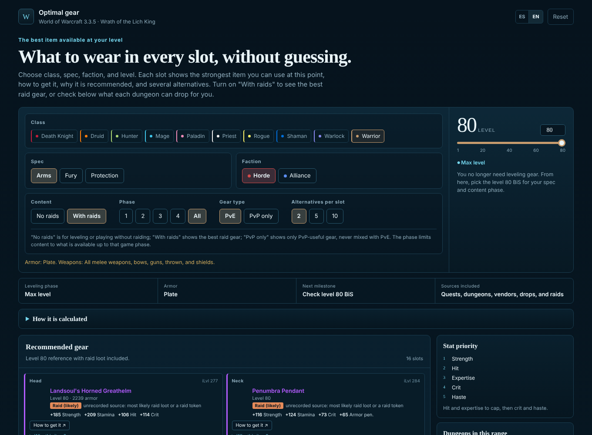

# WotLK Leveling Gear

**English** | [Español](README.es.md)

[](LICENSE)


A static, client-side guide that answers one question:

> What is the strongest item I can equip in each slot at my current level?

It supports all 10 WotLK classes, 31 specializations, levels 1–80, Horde/Alliance, and both English and Spanish.



## Features

- **Full equipment sheet**: head, neck, shoulders, back, chest, wrists, hands, waist, legs, feet, rings, trinkets, main hand, off hand, ranged, and relic.
- **Best item per slot** with 2, 5, or 10 alternatives, ranked by score (not by source).
- **How to get it**: every item shows its source (quest, vendor, dungeon boss with drop chance, raid, rare drop) and links to its EVOWOW page.
- **"Why this item?"** per slot: score breakdown by stat, armor-type penalty, comparison with the next alternative, and a warning when a higher item level option is hidden or weaker.
- **Content modes**: "No raids" (default) or "With raids", raid phase 1–4 or All, and a separate "PvP only" mode (PvE is the default; PvP gear is never mixed into PvE recommendations).
- **Dungeon loot from your gear**: enter what your character is wearing (or load the recommended set), pick a dungeon, and see every item it can drop for your class and spec with the % change over your equipped piece. The same flow is meant to extend to raids.
- **Faction-aware**: quests and vendors are filtered for Horde or Alliance.
- **Bilingual UI**: Spanish and English.
- **Item details**: icon, quality color, item level, required level, relevant stats, and source.
- **Heirloom panel**: separate from the main ranking, with tooltips scaled to the selected level.
- **EVOWOW tooltips** for every item.
- **Responsive layout** and persisted selection (`localStorage`).
- **No backend** and no build step required to view the page.

## How it works

1. `scripts/fetch_raw.py` downloads the raw item and zone data.
2. `scripts/build_item_db.py` normalizes items, stats, required levels, armor/weapon metadata, and sources.
3. `scripts/build_recommendations.py` emits the item database, spec definitions, stat weights, and dungeon list. The ranking itself runs in the browser, so mode, phase, PvP, and faction filters apply instantly.
4. `scripts/build_page.py` injects the generated JSON into `src/template.html` and writes `tolltip.html`.

The ranking is a practical heuristic, not a combat simulator: it sorts by a weighted stat score (item level only breaks ties) and penalizes armor types that are not ideal for the class. Epic items with no recorded source at item level 213 or higher are treated as raid loot ("likely raid"). Hit/expertise caps, gems, set bonuses, proc effects, and full weapon loadouts are not modeled yet.

## Quick start

Clone the repository and open `tolltip.html` in a browser.

Internet access is required for Google Fonts and EVOWOW item tooltips. The page itself works without a local server.

## Build from source

Requirements:

- Python 3.10+
- Playwright + Chromium for the smoke test

```bash
python -m pip install playwright
python -m playwright install chromium

python scripts/fetch_raw.py
python scripts/build_item_db.py
python scripts/build_recommendations.py
python scripts/build_page.py

python tests/smoke.py
```

`build_page.py` writes `tolltip.html` in the repository and, when available, to `~/Desktop/tolltip.html`.

## Project structure

```text
.
├── data/                  # generated gear_data.json (raw data is ignored)
├── docs/                  # README screenshots
├── legacy/                # previous heirloom-only implementation
├── scripts/               # data pipeline, ranking, and page builder
├── src/                   # HTML/CSS/JS template
├── tests/                 # Playwright smoke test
├── tolltip.html           # generated standalone page
├── CONTRIBUTING.md        # contribution guide (English)
├── CONTRIBUTING.es.md     # contribution guide (Spanish)
└── LICENSE
```

## Data and attribution

The item database is derived from [wow-classic-items](https://github.com/nexus-devs/wow-classic-items):

- `data/json/data.json`
- `data/json/zones.json`

Item tooltips and icons are loaded from [EVOWOW](https://wotlk.evowow.com/).

This project is not affiliated with Blizzard Entertainment. World of Warcraft and Wrath of the Lich King are trademarks of Blizzard Entertainment.

## Limitations

- The dataset is based on WotLK Classic; a few original 3.3.5 sources may be missing or labeled as “Other source”.
- Raid loot is intentionally excluded, but some raid quest rewards can still be labeled as quests.
- Stat weights are role-based approximations. They are designed to be useful while leveling, not to replace a full BiS simulator.
- Some very low-level slots may legitimately have no item with known stats.
- The generated page embeds the item data, so `tolltip.html` is intentionally large (around 4.5 MB).

## Contributing

Bug reports, item corrections, translations, and UI improvements are welcome. See [CONTRIBUTING.md](CONTRIBUTING.md).

## License

[MIT](LICENSE) © 2026 veksir
