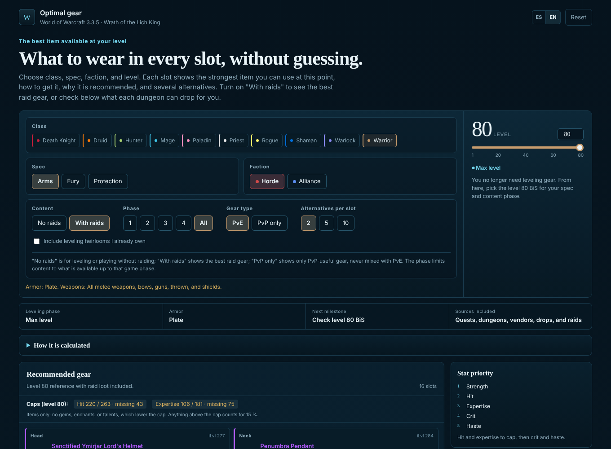

# WotLK Leveling Gear

**English** | [Español](README.es.md)

[](LICENSE)


Leveling guide and level 80 BiS planner for WotLK Classic. It answers one question:

> What is the strongest item I can equip in each slot at my current level?

Supports all 10 WotLK classes, 31 specializations, levels 1–80, Horde/Alliance, and both English and Spanish.



## Contents

- [What it does](#what-it-does)
- [Quick start](#quick-start)
- [Features](#features)
- [How it works](#how-it-works)
- [Build and test](#build-and-test)
- [Data and attribution](#data-and-attribution)
- [Limitations](#limitations)
- [Contributing](#contributing)
- [License](#license)

<a id="what-it-does"></a>
## What it does

- **Best item per slot** while leveling or at level 80, with 2, 5, or 10 alternatives ranked by score.
- **Level 80 route**: enter your gear, choose your server stage, and see every upgrade over what you wear.
- **BiS by phase**: Fresh 80, Heroics, T7, T8, T9, and T10, with BiS, BiS², and ALT picks.
- **Gear model**: gems, meta gems, enchants, set bonuses, trinket procs, hit/expertise caps, and class relics.
- **Loot browser**: pick a dungeon or raid and compare every drop with your equipped piece.
- **One generated page**: no backend, no server, and fonts embedded. Tooltips and icons come from EVOWOW; icons can be embedded for offline use.

## Quick start

1. Clone the repository or download `tolltip.html`.
2. Open `tolltip.html` in a browser.
3. Choose class, specialization, level, faction, and content mode. At level 80, enter your current gear to use the route and BiS tabs.

The page works without a local server. Tooltips and icons come from EVOWOW; icons can be embedded for offline use with `--icons`.

<a id="features"></a>
## Features

### Leveling

- **Full equipment sheet**: head, neck, shoulders, back, chest, wrists, hands, waist, legs, feet, rings, trinkets, main hand, off hand, ranged, and class relic.
- **Best item per slot** with 2, 5, or 10 alternatives, ranked by score.
- **How to get it and why**: source for every item, EVOWOW link, score breakdown, armor penalty, next alternative, and hidden/weaker warnings.
- **Content modes**: "No raids" (default) or "With raids", raid phase 1–4 or All, "PvP only", and "Fresh 80" (hides Frost, T10, raid tokens, and PvP gear).
- **Leveling coverage**: random-enchant items use the best suffix for your spec; white armor-only items fill empty slots; empty slots show the best available option with a notice.
- **Legendaries, class relics, and optional heirlooms**: legendaries appear when they rank; relics are normal gear; all 35 heirlooms use exact per-level stats but stay optional.

### Level 80 and BiS

- **Progression**: at level 80 the BiS panel comes first and starts with Fresh 80, then Heroics (PR), then raids.
- **3-step route**: enter gear, choose server stage, and see every upgrade over what you wear, sorted by gain (+X%), with its source.
- **BiS by phase**: Fresh 80, PR, T7, T8, T9, and T10 tabs (cumulative), with **BiS**, **BiS²**, and **ALT1–ALT6**.
- **Curated T10 and phased raids**: T10 can use the Icy Veins guide; raid gear enters when its tier opens, and each slot shows "Later" changes.
- **Farming plan and finder**: group missing BiS pieces by source, or type a drop to see whether it fits and where it ranks.
- **Editable weights, export/import/share, and equipped marks**: adjust stat weights, share gear as text or a `#eq=` link, and see what you already wear.

### Gear model

- **Proc-aware trinkets**: on-use and proc effects are averaged by duration and cooldown (≈); curated lists take priority.
- **Gems and meta gems**: best gem per color, socket bonuses only when colors are respected, and meta gems only when requirements and activation cost are met. The meta gem plan suggests swaps.
- **Set bonuses and caps**: T10 2/4-piece estimates are shared only among recommended pieces; hit/expertise above the cap count for 15%.
- **Enchants with alternatives**: each slot shows the guide's enchant and alternatives; the best shared stat moves to first place, and links search EVOWOW by name.

### Interface and data

- **Loot browser**: pick a dungeon or raid and compare every drop with your equipped piece; off-spec loot is hidden by default.
- **Faction-aware and bilingual**: Horde/Alliance filters, Spanish/English UI, item icons, quality, item level, stats, and source.
- **EVOWOW tooltips** for every item, with responsive layout and persisted selection in `localStorage`.
- **Navigation and design**: sticky section bar, collapsible mobile filters that remember your choice, visible keyboard focus, 11 px minimum text, larger touch targets, and clean printing.
- **No backend**: one generated page, no server, and fonts embedded.

<details>
<summary><strong>Advanced and optional</strong></summary>

- **BiS guides per phase**: only the T10 guide ships with the repo. To add another phase, paste its list into a text file (`Head: Item A; Item B`, one slot per line), run `python scripts/import_bis_list.py "Paladin|Protection" PR list.txt`, then `python scripts/build_recommendations.py`, and finally `python scripts/build_page.py`. The list is stored in `data/reference_bis_phases.json`; commit it if you want that guide to ship.
- **Offline icons**: `python scripts/fetch_icons.py` downloads the icons used by BiS by phase into `assets/icons/`, and `python scripts/build_page.py --icons assets/icons` embeds them. The page grows by several MB; without that step icons load from EVOWOW.
- **Compressed HTML**: `python scripts/build_page.py` writes a compressed `tolltip.html` (~1.4 MB). `--plain` writes it uncompressed.

</details>

<a id="how-it-works"></a>
## How it works

1. `scripts/fetch_raw.py` downloads raw item and zone data; `scripts/fetch_heirloom_stats.py` adds level-by-level heirloom stats; `scripts/fetch_atlasloot.py` and `scripts/build_loot.py` add per-boss WotLK loot tables.
2. `scripts/build_item_db.py` normalizes items, stats, required levels, armor/weapon metadata, and sources.
3. `scripts/build_recommendations.py` emits the item database, spec definitions, stat weights, reference gems and meta gems, T10 set bonuses, curated trinkets/relics, BiS guides, and the dungeon list.
4. `scripts/build_page.py` runs the Vite build over `src/` (HTML, CSS, and ES modules) and writes the single-file `tolltip.html`.

The ranking is a practical heuristic, not a combat simulator. It sorts by a weighted stat score, uses per-spec priorities at level 80 and role weights while leveling, penalizes armor types that are not ideal for the class, and compares two-handers against one-hand + off-hand.

It also averages trinket procs, chooses gems by color, activates socket bonuses only when colors are respected, uses a meta gem only when its requirements are met, shares the T10 set bonus only among recommended pieces, and applies hit/expertise caps at level 80. Enchant alternatives are ranked only by the stat they share; random-enchant items are not scored.

<a id="build-and-test"></a>
## Build and test

<details>
<summary>Show build commands and test notes</summary>

Requirements:

- Python 3.10+
- Node.js 22.12+ (or 20.19+) and npm
- Playwright + Chromium for browser tests

```bash
npm ci
python -m pip install -r requirements.txt
python -m playwright install chromium

python scripts/fetch_raw.py
python scripts/fetch_heirloom_stats.py
python scripts/fetch_atlasloot.py
python scripts/build_loot.py
python scripts/build_item_db.py
python scripts/build_recommendations.py
python scripts/build_page.py
```

`build_page.py` writes `tolltip.html` in the repository and, when available, to `~/Desktop/tolltip.html`. Use `--plain` to skip compression.

Optional guides and icons:

```bash
python scripts/import_bis_list.py "Paladin|Protection" PR list.txt
python scripts/build_recommendations.py
python scripts/build_page.py

python scripts/fetch_icons.py
python scripts/build_page.py --icons assets/icons
```

Tests:

```bash
python tests/run_all.py
python tests/check_reference.py
```

`run_all.py` runs the 16 browser/data tests used by the project. `check_reference.py` is an accuracy audit against the Icy Veins reference lists; the current baseline is **493/518** hits (431 exact), and `--min=497` fails today, so it is not part of `run_all.py`. See [CONTRIBUTING.md](CONTRIBUTING.md) for the individual test descriptions.

</details>

<a id="project-structure"></a>
## Project structure

<details>
<summary>Show project structure</summary>

```text
.
├── assets/fonts/          # bundled Cinzel and Source Sans 3 (OFL)
├── assets/icons/          # optional embedded item icons (generated)
├── data/                  # generated gear_data.json (raw data is ignored)
├── docs/                  # README screenshots
├── legacy/                # previous heirloom-only implementation
├── scripts/               # data pipeline, ranking, and page builder
├── src/                   # Vite source: index.html, styles/, js/
├── tests/                 # Playwright smoke and regression tests
├── tolltip.html           # generated standalone page
├── package.json           # Vite build dependencies and scripts
├── vite.config.js         # single-file build configuration
├── README.md              # README (English)
├── README.es.md           # README (Spanish)
├── CONTRIBUTING.md        # contribution guide (English)
├── CONTRIBUTING.es.md     # contribution guide (Spanish)
└── LICENSE
```

</details>

<a id="data-and-attribution"></a>
## Data and attribution

- **Items**: [wow-classic-items](https://github.com/nexus-devs/wow-classic-items), from `data/json/data.json` and `data/json/zones.json`.
- **Loot tables**: [AtlasLootClassic](https://github.com/Hoizame/AtlasLootClassic).
- **Tooltips and icons**: [EVOWOW](https://wotlk.evowow.com/).
- **Heirloom stats**: [WoWWiki archive](https://wowwiki-archive.fandom.com/) level tables and the [Wowhead WotLK tooltip API](https://www.wowhead.com/wotlk).
- **Level 80 weights**: [Icy Veins WotLK Classic](https://www.icy-veins.com/wotlk-classic/), calibrated with [WowSims](https://wowsims.github.io/wotlk/) EP values when available. See `data/spec_weights.json` and `data/reference_spec_stats.json`.
- **Reference gems, sets, trinkets, and meta gems**: stored in `data/reference_gems.json`, `data/reference_sets.json`, `data/reference_trinkets.json`, and `data/reference_meta_gems.json`, with sources in each file.

This project is not affiliated with Blizzard Entertainment. World of Warcraft and Wrath of the Lich King are trademarks of Blizzard Entertainment.

<a id="limitations"></a>
## Limitations

<details>
<summary>Show known limitations</summary>

- The dataset is based on WotLK Classic; a few original 3.3.5 sources may be missing or labeled as "Other source".
- "No raids" excludes raid loot and raid quest chains; "With raids" includes them.
- "Fresh 80" does not score the T9 set bonus and does not distinguish seasonal event availability; it filters by currency/source.
- Stat weights are role-based while leveling and follow Icy Veins priorities, calibrated with WowSims when available, at level 80. They are useful guidance, not a full BiS simulator; haste soft caps and talent interactions are not modeled.
- Gems are chosen by color and socket bonuses only activate when colors are respected. The meta gem uses a heuristic EP cost documented in `data/reference_meta_gems.json` and does not model every activation effect.
- Enchant alternatives only compare the stat they share; random enchants are not scored, and some trinket/set interactions are simplified.
- Below level 80 the previous approximation remains: one recommended gem per socket and socket bonuses count for half.
- The level-80 beam search only covers armor and rings; weapons, off-hand, ranged, trinkets, and relics keep their greedy or curated calculation.
- The T10 set bonus is an estimate shared only among the pieces recommended by the guide; it is not a full simulation of 2-piece/4-piece uptime.
- Off-spec loot is hidden by default. The toggle reveals it faded so you can judge cross-spec upgrades without mixing it into the recommendation.
- Leveling heirlooms are not recommended by default: Emblems of Heroism and Wintergrasp Marks are earned at level 80. Enable "Include leveling heirlooms I already own" only if you actually have them.
- Some very low-level slots may legitimately have no item with known stats.
- The page shows the best item plus alternatives per slot, not every item. A legendary only appears if it ranks for the selected spec, level, faction, mode, phase, and PvP filter.
- Weapon combinations cover dual-wield Frost Death Knights and Fury's Titan's Grip. Other special setups remain simplified.
- Some long gemming notes are Spanish only.
- The generated page embeds the item data and gzip-compresses its code; `tolltip.html` is about 1.4 MB (the uncompressed Vite build is about 6.6 MB).

</details>

<a id="contributing"></a>
## Contributing

Bug reports, item corrections, translations, and UI improvements are welcome. See [CONTRIBUTING.md](CONTRIBUTING.md).

<a id="license"></a>
## License

[MIT](LICENSE) © 2026 veksir
